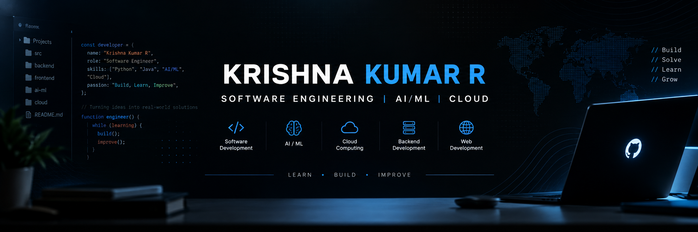

  

 

# KRISHNA KUMAR R

### Software Engineer | Python • Java • AI/ML • Cloud

B.Tech Information Technology | SRM IST, Tiruchirappalli

Building practical software solutions through programming,
backend development, and AI-driven applications.

---

## About Me

I'm a B.Tech Information Technology student at SRM Institute
of Science and Technology, graduating in 2027.

My interests include software engineering, backend development,
Python programming, artificial intelligence, and cloud computing.

I enjoy solving programming problems, developing practical
applications, and improving my technical skills through projects.

- 🎓 B.Tech Information Technology — 2027
- 💻 Interested in Software Engineering and Backend Development
- 🤖 Exploring AI/ML and Generative AI
- ☁️ Learning Cloud Technologies
- 🧩 Practising Data Structures and Algorithms
- 🚀 Focused on building useful, maintainable applications

---

## Technical Skills

| Category | Technologies |
|---|---|
| Programming | Java, Python, JavaScript, SQL |
| Web Development | HTML, CSS, JavaScript |
| Backend | REST APIs, JSON, Flask |
| Database | MySQL |
| AI & Data | Machine Learning, NLP, Data Preprocessing |
| Tools | Git, GitHub, VS Code |
| Core Concepts | OOP, DSA, Debugging, Problem Solving |

---

## Featured Projects

### 01. [BFHL Hierarchy Processing API](https://github.com/krixhhh/bfhl-project-)

A REST API that processes hierarchical JSON data and generates
structured responses.

### 02. [GARDIO — AI Outfit Recommendation](https://github.com/krixhhh/GARDO)

A digital wardrobe application with personalized outfit recommendations.

### 03. [Client Project Dashboard](https://github.com/krixhhh/client-project-dashboard)

A real-time internal SaaS dashboard designed for software development agencies. Built with React, Node.js, Express, TypeScript, Prisma ORM, PostgreSQL, Socket.IO, Redis, and BullMQ.

### 04. [Smart Parking System](https://github.com/krixhhh/smart-parking-system-iot-cv)

An IoT and computer vision-based parking monitoring system.

---

## Experience

**Full Stack Web Development Intern**  
8Queens Software Technologies Pvt. Ltd.

**Backend Development Intern**  
VDart

Worked on web development, REST APIs, JSON processing,
application debugging, and backend application logic.

---

## Certifications

- Microsoft Azure Fundamentals — Infosys Springboard
- Artificial Intelligence Fundamentals — IBM SkillsBuild
- Generative AI for All — Infosys Springboard
- Natural Language Processing — Infosys Springboard
- Programming with JavaScript — Meta / Coursera
- Programming for Everybody (Python) — University of Michigan
- Full Stack Web Development Internship — 8Queens
- Backend Development Internship Training — VDart

---

## Current Focus

- Strengthening Data Structures and Algorithms
- Building reliable backend applications
- Improving Python and Java programming
- Exploring AI/ML applications
- Learning cloud computing fundamentals

---

### Learn. Build. Improve.

*Focused on continuous learning and practical software development.*

